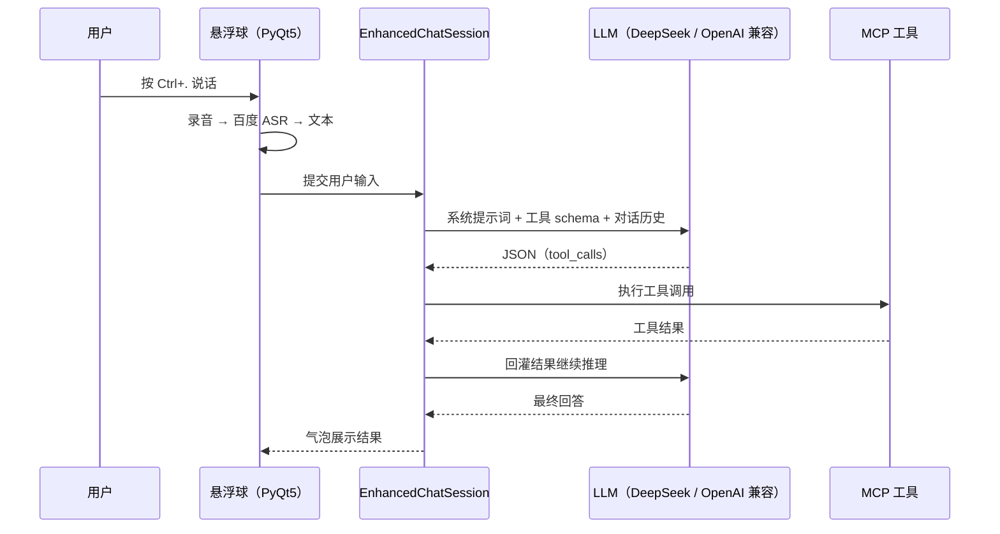
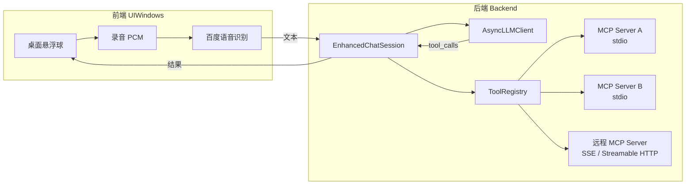

# 桌面悬浮窗 MCP 任务 Agent

> 说一句话，让 AI 自己拆任务、调工具、操作 Windows 桌面。


## 项目简介

一个运行在 Windows 桌面的「语音 → LLM → MCP 工具 → 桌面操作」Agent。

- **前端**是一个置顶无边框的**桌面悬浮球**（PyQt5 自绘），不占任务栏、不打断当前工作；
- 按下全局快捷键说话 → **百度语音识别**转文字 → 后端 **LLM 决策** → 通过 **MCP（Model Context Protocol）** 调用本地/远程工具（文件系统、Word、Excel、PDF、Windows 桌面自动化等）→ 结果以气泡形式回显。

目标是把大模型从「能聊天」变成「能替我操作桌面」：工具接入标准化（MCP），交互简化为「说一句话」。

## 功能特性

| 能力 | 说明 |
| --- | --- |
| 🎙 语音即入口 | 全局快捷键 `Ctrl + .` 开始录音，`Ctrl + Shift + .` 随时中止 |
| 🫧 桌面悬浮球 | 无边框置顶、可拖动、悬停展开、录音/推理状态文字、结果气泡；右键菜单可设置、管理工具、退出 |
| 🧠 多跳工具调用闭环 | LLM 返回 `tool_calls` → 执行工具 → 结果回灌 → 继续推理，最大深度 50；单轮失败自动重试 3 次 |
| 🔌 多 MCP 传输 | `stdio` / `SSE` / `Streamable HTTP` 三种连接方式统一管理，按配置自动判定连接类型 |
| 🧰 工具注册与路由 | 聚合多个 MCP Server 的工具 schema，格式化后注入提示词，按名称路由执行 |
| 🛠 自研 MCP Server | 用 FastMCP 编写的桌面文件系统工具（`utils/DesktopMCP.py`） |
| ⚙️ 可视化设置 | 悬浮球大小/透明度/颜色/字号、悬停延时、快捷键，以及 MCP 工具查看与重新连接 |
| 🧵 单进程前后端桥接 | 子线程运行 asyncio 事件循环，`pyqtSignal` 跨线程回传，避免 GUI 卡死 |

## 交互流程



## 系统架构



- **配置层**：`ConfigurationManager` 加载 `.env` 与 JSON 服务器配置；
- **契约层**：`types.py` 定义 `ServerConfig` / `ToolSchema` / `ConnectionType`，`exceptions.py` 统一异常体系，`Protocol` 接口做依赖倒置；
- **服务层**：`AsyncLLMClient` 封装 LLM 调用；`MCPServer` 负责 MCP 连接与工具枚举；`ToolRegistry` 聚合多 Server 工具并路由执行；
- **会话层**：`EnhancedChatSession` 维护消息历史、拼装系统提示词、驱动多跳工具调用闭环；
- **前端**：`FloatingBall` 悬浮球 + `BackendWorker`（独立线程 + 事件循环）通过信号槽与主线程解耦。

## 目录结构

```text
.
├── Backend/                       # 后端 Agent 框架
│   ├── config/                    # 常量与配置加载（.env + JSON）
│   ├── core/                      # 类型契约、异常体系、Protocol 接口
│   ├── services/                  # LLM 客户端、MCP Server 连接、工具注册表
│   ├── session/                   # 多跳对话会话
│   ├── utils/                     # 对话历史、LLM 输出解析
│   ├── factory.py                 # 组装：配置 → LLM → 工具注册表 → 会话
│   └── main.py                    # 命令行入口
├── UIWindows/                     # PyQt5 前端
│   ├── ui/                        # 悬浮球、气泡、快捷键、工具管理面板
│   ├── audio/                     # PCM 录音
│   ├── services/                  # 百度语音识别
│   ├── config/                    # 前端设置读写
│   └── UI_main.py                 # GUI 入口（后台线程 + pyqtSignal 桥接）
├── utils/                         # 自研 MCP Server（FastMCP）
│   ├── DesktopMCP.py              # 桌面文件系统工具
│   └── Context.py                 # 上下文工具
├── docs/                          # 重构设计文档与项目结构说明
├── archive/                       # 历史版本（前身单体脚本、旧版前端，非当前入口）
├── requirements.txt
├── .env.example
├── winmcp1.example.json           # Windows-MCP 配置示例（复制为 winmcp1.json 后修改）
├── winmcp2.example.json           # Windows-MCP 另一种启动方式示例
├── omnimcp.example.json           # OmniMCP 配置示例
└── servers_config.example.json    # 多 Server 组合配置示例
```

## 快速开始

### 环境要求

- Windows 10 / 11（项目仅在 Windows 上开发验证）
- Python 3.11
- 可用麦克风
- DeepSeek API Key（或任意 OpenAI 兼容服务）
- 百度智能云语音识别 API Key / Secret Key

### 1. 安装依赖

```bash
git clone https://github.com/NightR71/desktop-mcp-agent.git
cd desktop-mcp-agent

python -m venv .venv
.venv\Scripts\activate

pip install -r requirements.txt
```

> PyAudio 若安装失败，请下载对应 `cp311` 的 wheel 后本地安装。

### 2. 配置 API Key

```bash
copy .env.example .env
```

编辑 `.env`，填入：

| 变量 | 用途 | 是否必需 |
| --- | --- | --- |
| `DEEP_API_KEY` | DeepSeek（或 OpenAI 兼容服务）密钥 | 必需 |
| `VOICE_API_KEY` / `SECRET_API_KEY` | 百度短语音识别 | 必需 |
| `MODELSCOPE_API_KEY` | 魔搭远程 MCP / 模型服务 | 可选 |
| `Zai_API_KEY` | 智谱 GLM（代码中保留的可选后端） | 可选 |

### 3. 配置 MCP Server

```bash
copy winmcp1.example.json winmcp1.json
```

把 `winmcp1.json` 里的 `C:\path\to\Windows-MCP` 改成你本机的实际路径。其他示例按需复制使用：

- `winmcp1.example.json` / `winmcp2.example.json`：Windows 桌面自动化 MCP Server 的两种启动方式（`uv` 或虚拟环境 Python）；
- `omnimcp.example.json`：OmniMCP 配置示例；
- `servers_config.example.json`：多 Server 组合示例（文件系统 / Word / Excel / PDF / 远程 SSE），其中 `filesystem`、`word-document-server` 依赖下节的第三方 Server。

**第三方 MCP Server 不随本仓库分发**，需要时自行获取：

| Server | 用途 | 获取方式 |
| --- | --- | --- |
| Windows-MCP | Windows 桌面自动化 | <https://github.com/CursorTouch/Windows-MCP> |
| Office-Word-MCP-Server | Word 文档读写 | <https://github.com/GongRzhe/Office-Word-MCP-Server>（MIT） |
| undoom-pdf-mcp | PDF 处理 | `uvx undoom-pdf-mcp`（<https://github.com/kk520879/undoom_pdf_mcp>，MIT） |
| excel-mcp-server | Excel 处理 | `uvx excel-mcp-server` |

### 4. 启动

图形界面（推荐）：

```bash
python UIWindows/UI_main.py
```

命令行（在项目根目录运行，配置文件名相对于当前目录）：

```bash
python Backend/main.py winmcp1.json
```

启动后：

- 悬浮球出现并自动连接配置中的 MCP Server，成功后气泡提示「MCP服务连接成功！」；
- 按 `Ctrl + .` 说话，说完再按一次（或按 `Ctrl + Shift + .`）结束录音；
- 右键悬浮球：停止运行 / 设置 / 新增工具 / 退出；
- 首次连接失败会弹出「新增工具」面板，可修改配置后重连。

## 配置说明

MCP 服务器配置采用标准 `mcpServers` 结构，支持三种连接类型：

```json
{
  "mcpServers": {
    "本地服务": {
      "command": "python",
      "args": ["utils\\DesktopMCP.py"],
      "env": { "KEY": "VALUE" }
    },
    "远程服务": {
      "type": "sse",
      "url": "https://example.com/mcp/sse"
    }
  }
}
```

- 含 `command` 的条目按 `stdio` 启动（`command` / `args` / `env` 生效）；
- 含 `url` 的条目按远程连接处理，`type` 可指定 `sse` 或 `streamable_http`（缺省为 `streamable_http`）；
- `uvx` / `npx` 类命令会自动解析可执行文件位置。

前端外观与快捷键保存在 `UIWindows/UIsettings.json`（运行时生成，已被 `.gitignore` 排除），也可在悬浮球右键「设置」里修改。

## 核心机制

### 一次语音任务的完整链路

1. 悬浮球捕获全局快捷键，录音并调用百度短语音识别得到文本；
2. 文本经 `pyqtSignal` 送入后台线程，交给 `EnhancedChatSession.process_user_input`；
3. 会话把「系统提示词 + 所有 MCP 工具 schema + 最近对话」发给 LLM；
4. LLM 以 JSON 形式返回一个或多个 `tool_calls`，`ToolRegistry` 按工具名路由到对应 MCP Server 执行；
5. 工具结果以 `tool` 消息回灌给 LLM，继续下一跳推理，直到产生最终回答（深度上限 50，防止死循环）；
6. 最终回答经信号回传主线程，显示在悬浮球气泡中。

### 错误处理

- LLM 调用失败自动重试 3 次（`Constants.DEFAULT_RETRY_COUNT`）；
- 单个 MCP Server 初始化失败不会阻断整体启动，其余 Server 正常可用；
- 工具执行异常会作为错误结果回灌给 LLM，由模型决定是否换一种方式重试；
- LLM 输出非 JSON 时走解析兜底，按普通文本回答返回。

### 前后端桥接

`BackendWorker` 在独立线程中运行 asyncio 事件循环，UI 侧通过 `pyqtSignal` 接收 `response_received` / `init_success` / `init_error`；UI 操作通过 `asyncio.run_coroutine_threadsafe` 投递到后台线程，保证 PyQt 主线程不被阻塞。

## 已知限制

- 仅在 Windows 11 + Python 3.11 上验证，未做跨平台适配（全局键盘钩子、桌面自动化均依赖 Windows）；
- 需要自备 LLM 与语音识别 API Key，开箱即用程度有限；
- 百度短语音识别单次时长有限（约 60 秒），长语音需另行分段；
- 第三方 MCP Server 不随仓库分发，配置中的绝对路径需按本机环境修改；
- 项目为个人实践项目，没有自动化测试；`archive/` 下为历史脚本，仅作留档，不是当前入口。

## 第三方组件与许可

- 本仓库代码以 **MIT** 许可发布，见 [LICENSE](LICENSE)；
- 桌面 GUI 使用 **PyQt5**（GPLv3 / 商业双许可）。若需分发可执行程序，请自行评估 PyQt5 的许可约束，或改用 LGPL 的 PySide6；
- MCP 客户端/服务端基于官方 **MCP Python SDK**；
- LLM 调用基于 **OpenAI Python SDK**（Apache-2.0）；
- 配置示例中引用的第三方 MCP Server 版权归各自作者所有，许可分别为 MIT（Office-Word-MCP-Server、undoom-pdf-mcp）或见上游仓库。

## 安全提示

桌面自动化类工具权限较大（可操作文件、键鼠、窗口），请只连接可信的 MCP Server；`servers_config.example.json` 中的远程 SSE 地址为占位符，请勿把包含个人凭证的配置提交到仓库。

## License

[MIT](LICENSE) © 2025-2026 NightR71
